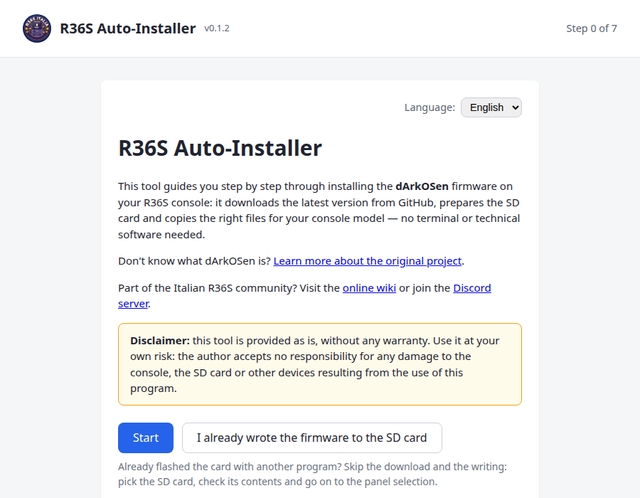
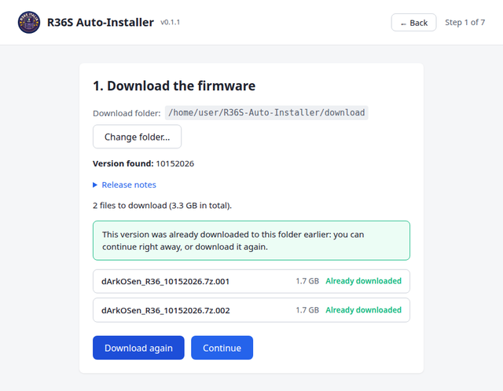
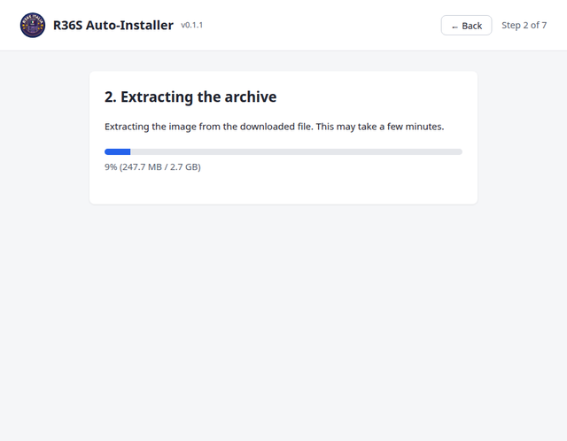
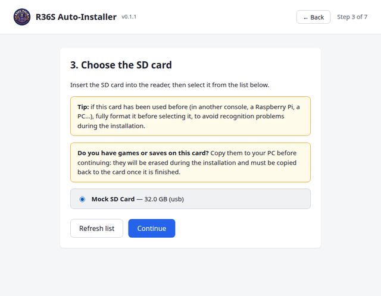
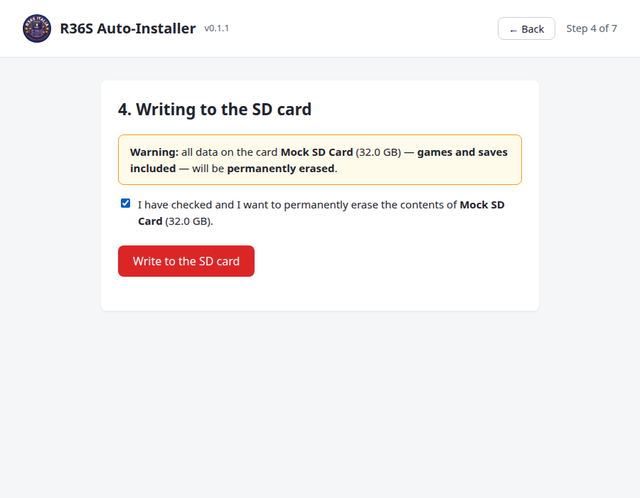
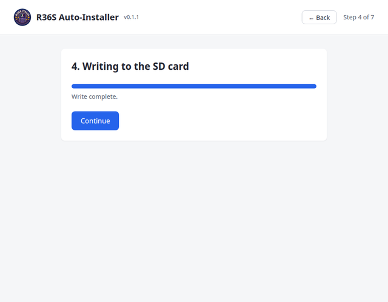
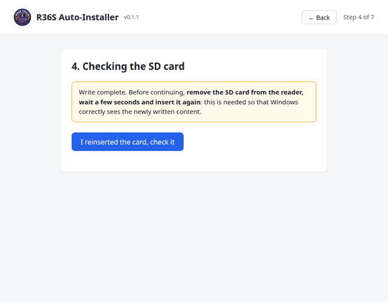
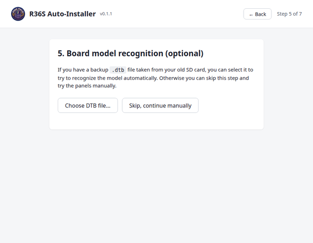
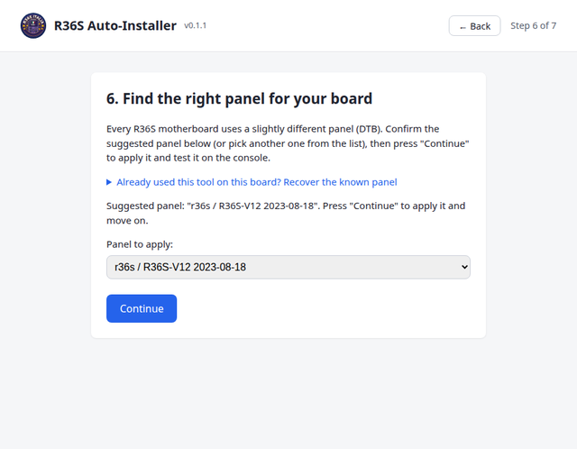
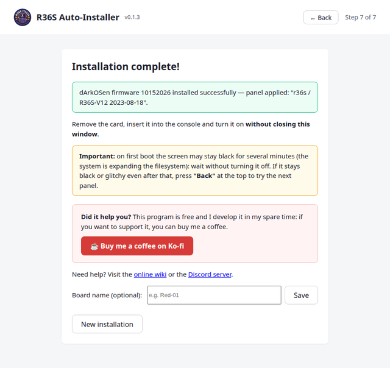

# R36S Auto-Installer

🇮🇹 [Versione italiana](./README.md)

**R36S Auto-Installer** is a free Windows program that automates installing the **dArkOSen** firmware on your R36S console. It guides you step by step: it downloads the latest version from GitHub, prepares the SD card and copies the right files for your motherboard model — **no terminal or technical tools needed**. The program interface is available in Italian and English.

## ⬇️ Download

<!-- The file name includes the version: update this link with every new release published (keep in sync with README.md). -->
**[Download the latest version](https://github.com/chrisdaloa/R36S-Autoinstaller-releases/releases/download/v0.1.2/R36S.Auto-Installer_0.1.2_x64-setup.exe)** — direct link to the executable, no need to go through the Releases page.

> This repository only contains the ready-to-download executables. The project's source code lives in a separate repository. The [Releases](https://github.com/chrisdaloa/R36S-Autoinstaller-releases/releases) page also lists an alternative `.msi` installer and a `latest.json` file (used only internally by the program to check for updates, you don't need to download it).

> **Before you start:** you need an SD card reader (built-in or USB), an **empty or already formatted** SD card of at least 8 GB, and an internet connection to download the firmware (about 2-3 GB). **Requires Windows 10 or 11** — it is not compatible with Windows 7/8.1 (systems no longer supported by Microsoft): the program cannot even start on those versions.

> **Disclaimer:** this tool is provided as is, without any warranty. Use it at your own risk: the author accepts no responsibility for any damage to the console, the SD card or other devices resulting from the use of this program.

> [!WARNING]
> **Back up your games:** this tool does not download or install games on the SD card, so you need to back up the games from your SD card and then copy them to the new SD card when the procedure is finished.

### ⚠️ Before starting the program

- **Run the program as administrator** (right-click the executable → **Run as administrator**): this is needed to write to the SD/USB card, otherwise writing fails.
- **Windows may show a security warning at startup** ("Windows protected your PC" / SmartScreen), because the program is not signed with a paid certificate. This is normal for a free program distributed this way: click **More info** and then **Run anyway** to continue.

---

## Step 0 — Welcome

When the program starts you will see a short introduction, a link to the original dArkOSen project and links to the Italian community (online wiki and Discord server) where you can ask for help if something goes wrong.

At the top of the screen you will find the **Language** selector (Italiano / English): the program starts in your system's language, but you can change it here.

Press **Start** to continue.

> **Already wrote the firmware to the SD card with another program?** Press **I already wrote the firmware to the SD card**: you skip the download, the extraction and the writing, pick the card (Step 3), the program checks its contents (Step 4, check) and you carry on with the panel selection (Steps 5 and 6). In this path the card is neither erased nor rewritten.

---

## Step 1 — Download the firmware

The program automatically checks GitHub for the latest available dArkOSen firmware version and lists the files to download with their sizes.

- You can change the download folder with **Change folder...** if you want to save the files elsewhere.
- If a version was already downloaded earlier in the same folder, the program notices and lets you continue directly without downloading it again, or download it once more.
- Press **Continue** when the download has finished.

---

## Step 2 — Extracting the archive

The firmware is downloaded as a compressed archive split into several parts (`.7z.001`, `.7z.002`, ...). The program extracts it automatically to obtain the operating system image to write to the SD card.

A progress bar shows the percentage completed. When it finishes, press **Continue**.

---

## Step 3 — Choose the SD card

Insert the SD card into the reader. The program lists only removable disks (SD/USB) and **never lets you select your computer's system disk**, for safety.

> **Tip:** if the card has been used before (for another console, a Raspberry Pi, a PC...), format it completely before selecting it, to avoid recognition problems during installation.

> **Mind your games:** everything on the card will be erased. If it holds games or saves, copy them to your PC first and put them back on the card when the installation is finished.

Select your card from the list (check that the size and name match your SD card) and press **Continue**. If the card doesn't appear, use **Refresh list** after inserting it.

---

## Step 4 — Writing to the SD card

This is the step that **permanently erases** everything on the selected SD card, in order to write the new firmware to it. For safety, the program asks for explicit confirmation before proceeding.

Tick the confirmation box (it shows the name and size of the selected card — check that they are the right ones) to enable the **Write to the SD card** button.

While writing to a physical card you will see a progress bar with **percentage, speed (MB/s) and estimated time remaining**. Writing an image of several GB can take a few minutes, especially with slow SD readers: **do not close the program and do not remove the card while writing**, you could damage it.

When it finishes, press **Continue**.

---

## Step 4 (check) — Reinsert the SD card

After writing, the program asks you to **eject and reinsert the SD card**: this is needed so that your computer's operating system correctly sees the content that was just written (a known limitation of Windows and some SD readers, not a firmware problem).

Remove the card, wait a few seconds, reinsert it and press **I reinserted the card, check it**. The program checks that the card really contains the files just written before letting you continue.

---

## Step 5 — Board model recognition (optional)

Each R36S motherboard uses a slightly different graphics configuration file (**DTB panel**), and software cannot recognise it automatically: it has to be found by trial and error, or recovered from an old backup.

- If you have a backup `.dtb` file taken from your old SD card, you can select it with **Choose DTB file...** to try to recognise the model automatically.
- Otherwise press **Skip, continue manually** to choose the panel by hand in the next step.

---

## Step 6 — Find the right panel for your board

The program reads the panels available in the firmware you just wrote and suggests one to start with.

- If you have already used this tool on this board in the past, you can use the **Already used this tool on this board? Recover the known panel** option to directly reapply the one you had already found working.
- Otherwise confirm the suggested panel (or pick another from the drop-down menu) and press **Continue** to apply it and test it on the console.

Don't worry if the first panel you choose is not the right one: from the next step you can go back and try another until the console screen works correctly.

---

## Step 7 — Installation complete

The chosen panel is applied and the program confirms that the installation is finished.

Read the first-boot notice carefully: **the console screen may stay black or show only a cursor for several minutes** on first boot, while the system expands the filesystem — this is normal, do not turn the console off and wait.

If after waiting the screen stays black or distorted, the panel you chose is not the right one for your motherboard: turn the console off, put the SD card back in the reader, press **"Back"** at the top of the program and try the next panel in the list (Step 6).

If you like, you can give the board a name (e.g. "Red-01"): the next time you use it with this program, the working panel will be remembered and suggested automatically, so you won't have to find it again from scratch.

---

## Problems with the analog sticks?

If the sticks on your console are **swapped or inverted** (to go up and down you have to move left and right), there is a fix script with its own guide: [Fixing the analog sticks](fix-stick/GUIDA.en.md).

---

## Need help?

If something doesn't work as expected, visit the [community's online wiki](https://pixelpocket.1612.it/r36s) (in Italian) or ask for support on the [Discord server](https://discord.gg/tusqNhr2V).
